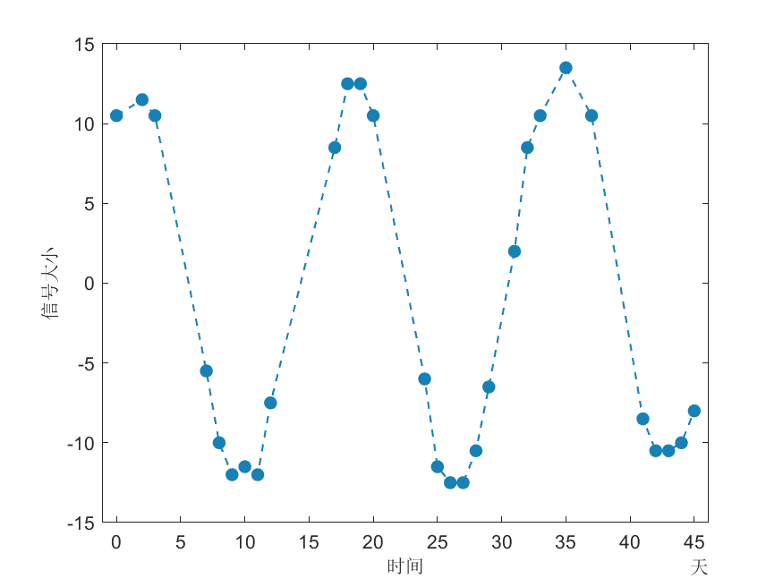
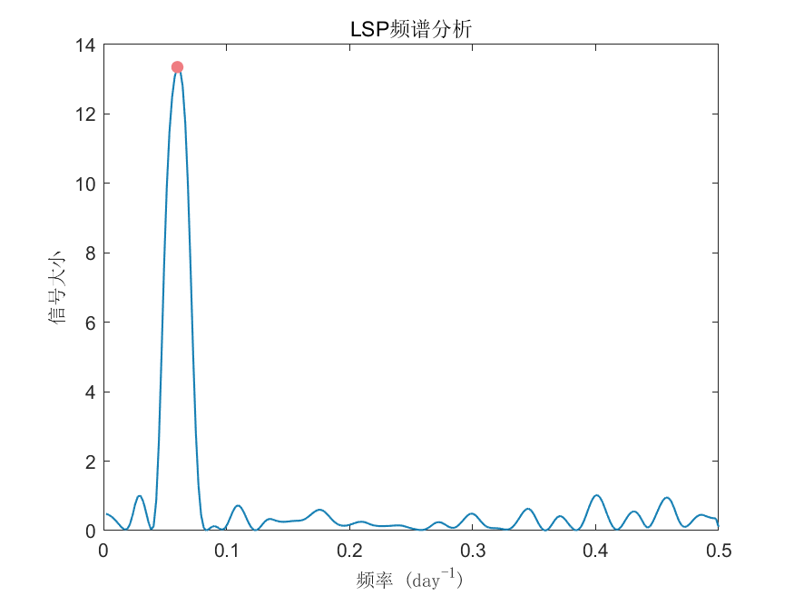

# MATLAB | Spectral Analysis Algorithm | LSP Spectral Analysis Algorithm | Includes data and plotting code | Directly Useable

1. Basic Definition
The LSP (Line Spectrum Pair) spectral analysis algorithm is a method for linear prediction analysis, which can perform rapid and accurate frequency domain analysis on digital signals. It is widely used in areas such as speech signal processing and audio coding. The steps of the LSP spectral analysis algorithm are as follows:
Preprocessing the given digital signal, which usually includes operations such as preemphasis, frame segmentation, and windowing to reduce non-stationarity and large dynamic range.
By means of linear prediction analysis, obtain the autoregressive model of the signal: x(n) = ∑(ai * x(n-i)) + e(n), where ai represents the autoregressive coefficients, and e(n) represents the noise term.
Perform LSP transformation on the autoregressive coefficients to obtain LSP coefficients.
Based on the LSP coefficients, calculate the power spectral density estimate of the signal. The advantage of the LSP spectral analysis algorithm is its high spectral resolution and estimation accuracy, providing good estimates for nonlinear components such as harmonics in the signal. Additionally, it has a fast computation speed suitable for real-time processing scenarios. However, this method requires multiple iteration calculations, leading to higher computational complexity, and may not be as effective in estimating higher order harmonics and other higher-order components compared to other methods.
2. Definition and Outline Effects
The outline effects are as follows:
\n        \n      \n        \n  
Video tutorial operation:
\n        \n          \n          \n          \n          \n            To view this video please enable JavaScript, and consider upgrading to a\n            web browser that\n            supports HTML5 video\n  

## Images

<!-- PAYMENT_BLOCK -->

## Get this dataset

- Payment link (Stripe): [Buy now](https://buy.stripe.com/3cs8yP7sY87d0vu9AB)
- Payment QR code: 

<!-- /PAYMENT_BLOCK -->
